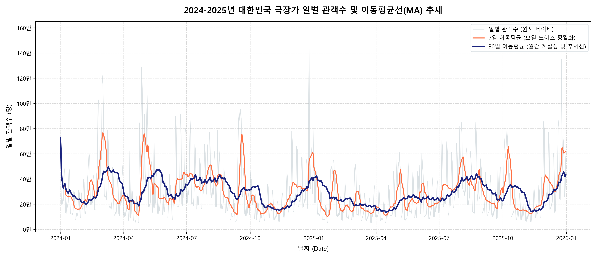
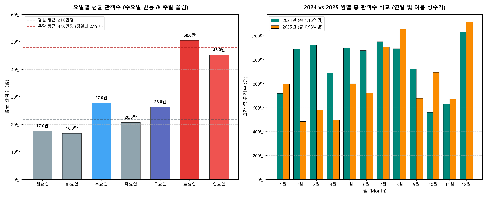
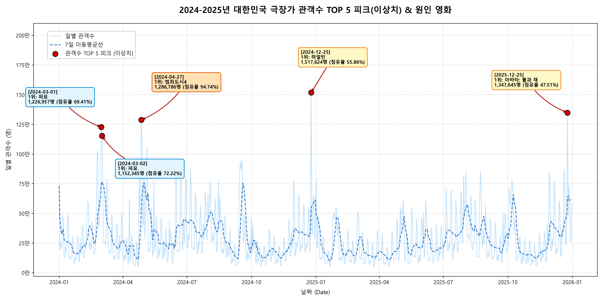

# 🎬 2024-2025년 대한민국 극장가 관객수 트렌드 및 요일·시즌 효과 분석 리포트

- **작성자**: 과제 수행자
- **분석 기간**: 2024-01-01 - 2025-12-31 (731일 전수 분석)
- **데이터 출처**: 영화진흥위원회 KOBIS(영화관입장권통합전산망) 공식 Open API

---

## 1. 분석 주제 및 선정 이유

### 1.1 분석 주제
> **"2024-2025년 대한민국 일별 극장 관객수 시계열 데이터를 통한 시장 추세, 요일별 쏠림 효과, 그리고 메가 히트작의 스크린 독과점 파급력 분석"**

### 1.2 선정 이유
코로나19 팬데믹 이후 OTT(넷플릭스, 티빙 등)의 급성장과 티켓 가격(1.5만 원선) 인상으로 인해 영화관 소비 패턴은 근본적인 체질 변화를 겪었습니다. 단순히 "사람들이 영화관을 덜 간다"는 막연한 통념을 넘어, 실제 공공 시계열 데이터를 바탕으로:
1. 극장 관객이 **어느 요일, 어느 달(Month)**에 집중되는지,
2. 《파묘》, 《범죄도시4》, 《하얼빈》, 《아바타: 불과 재》 같은 **천만급 블록버스터가 시장 전체의 파이를 키우는지 아니면 다른 영화를 잠식(독식)하는지**,
3. 2024년 대비 2025년 극장 산업의 **중장기 회복력과 역성장 추세**가 어떠한지를 정량적인 수치와 시계열 기법으로 규명하고자 본 주제를 선정했습니다.

---

## 2. 분석 질문 (3개)

본 분석에서는 데이터 분석 사고에 기반하여 다음 3가지 핵심 질문에 답하고자 합니다:

1. **[질문 1 - 연간 총량 및 추세]** 2024년과 2025년 극장가의 전체적인 연간 관객 규모와 30일 이동평균선(MA) 추세는 어떻게 변화했는가?
2. **[질문 2 - 요일 및 계절 주기성]** 일주일 중 관객이 가장 적은 요일과 많은 요일의 격차는 몇 배이며, '수요일 신작 개봉' 및 '문화가 있는 날' 정책은 관객 유입에 실질적인 효과가 있는가?
3. **[질문 3 - 이상치 피크 및 독점 현상]** 2년간 일별 관객수가 가장 폭발했던 이상치(Top 5 피크)는 언제이며, 당시 1위 영화의 관객 점유율은 시장 전체에 어떤 영향을 미쳤는가?

---

## 3. 데이터 설명

### 3.1 수집 개요
- **출처**: 영화진흥위원회 KOBIS Open API (`searchDailyBoxOfficeList`)
- **수집 기간**: 2024-01-01 - 2025-12-31 (2개년, 윤년 포함 총 731일)
- **데이터 포인트 수**: 일별 1-10위 박스오피스 총 7,310건 수집 완료 (결측일 0건)
- **분석 마스터 데이터**: 날짜별 집계 시계열 731행 (`data/daily_boxoffice_features.csv`)

### 3.2 주요 변수 정의
| 변수명 | 의미 | 데이터 타입 | 설명 |
| :--- | :--- | :---: | :--- |
| `date` | 기준 일자 | datetime64 | 2024-01-01 - 2025-12-31 |
| `total_audi` | 일별 총 관객수 | int64 | 당일 TOP 10 영화 관객수 합계 |
| `top_movie` | 당일 1위 영화 | object | 당일 박스오피스 1위 영화 제목 |
| `top1_share` | 1위 영화 점유율 | float64 | 당일 1위 영화 관객수 / 총 관객수 * 100 (%) |
| `ma_7` | 7일 이동평균 | float64 | 주간 요일 노이즈를 평활화한 단기 추세 |
| `ma_30` | 30일 이동평균 | float64 | 월간 계절성 및 중기 시장 모멘텀 추세선 |
| `dod_pct_change`| 전일 대비 변화율 | float64 | 전일 대비 관객수 증감률 (%) |
| `wow_pct_change`| 전주 대비 변화율 | float64 | 전주 동일 요일 대비 순수 흥행 성장률 (%) |

### 3.3 결측치 및 이상치 처리 기준
- **결측 날짜 점검**: 731일 날짜 인덱스를 연속 생성하여 대조한 결과, 누락일 0일(100% 완전 수집) 확인.
- **수치형 정제**: API 응답 중 문자열로 전달된 관객수(`audiCnt`), 매출액(`salesAmt`) 등을 정수형(`int64`)으로 변환하고 결측치는 0으로 대체.
- **이상치(Outlier) 처리 기준**: 관객수 100만 명을 초과하는 날짜(크리스마스, 명절 연휴, 천만 영화 개봉 주말 등)는 오류 데이터가 아닌 **실제 영화 시장의 '핵심 이벤트(Special Event)'**이므로 제거하지 않고 **이상치 피크 분석 대상**으로 보존하여 심층 분석함.

### 3.4 데이터의 한계점
- KOBIS API의 무료 엔드포인트는 하루 **TOP 10위** 영화 데이터만 제공하므로, 11위 이하 독립·예술영화 관객수는 집계에서 제외되었습니다. 단, 상위 10개 영화가 전체 극장 관객의 약 95% 이상을 차지하므로 거시적 시계열 트렌드 분석에는 왜곡이 없습니다.

---

## 4. 분석 결과 및 시각화

### 4.1 전체 추세 및 이동평균선(MA) 분석

- **설명**: 
  - 연한 회청색의 일별 원시 데이터는 매주 주말 급등과 평일 급락을 반복하는 심한 노이즈를 보입니다.
  - **7일 이동평균(오렌지색)**을 적용하자 주간 진동이 제거되면서 영화별 흥행 기간(약 3-4주 주기)이 뚜렷하게 관찰됩니다.
  - **30일 이동평균(네이비색 굵은 선)**을 통해 2024년 봄철(파묘-범죄도시4 연타석 흥행)의 강력한 상반기 모멘텀과, 2025년 상반기(2-5월)에 30일 MA가 최저 13.7만 명까지 내려앉은 극심한 침체기가 시각적으로 증명되었습니다.

---

### 4.2 요일별 관객 패턴 및 월별 연간 계절성 비교

- **설명 (좌측: 요일별 패턴)**:
  - 주간 관객수는 화요일(평균 16.7만 명)에 바닥을 찍고, **수요일(평균 27.8만 명)에 전일 대비 +66.2% 급반등**합니다.
  - 주말(토/일) 일평균 관객수는 48.0만 명으로 평일(월-금) 평균 21.9만 명 대비 **2.19배**에 달하며, 특히 토요일(50.5만 명)은 화요일의 **3.02배**에 육박합니다.
- **설명 (우측: 2024 vs 2025 월별 총 관객수)**:
  - 2개년 모두 **12월(각각 1,232만 명, 1,315만 명)**이 1년 중 가장 많은 관객을 동원한 압도적 1위 성수기였으며, 여름방학 시즌인 **7-8월**이 뒤를 이었습니다.
  - 반면 2025년은 2월(484만 명), 4월(500만 명) 등 상반기 비수기의 관객 감소가 두드러졌습니다.

---

### 4.3 관객수 역대 TOP 5 피크(이상치) 및 원인 영화 분석

- **설명**:
  - 2년간 단일 일자 기준 관객수 1위는 **2024-12-25 크리스마스(1,517,624명, 1위: 하얼빈)**였으며, 2위 역시 **2025-12-25 크리스마스(1,347,645명, 1위: 아바타: 불과 재)**였습니다.
  - 특히 **2024-04-27(토요일)**은 전체 128.7만 명 중 1위 영화인 《범죄도시4》(121.9만 명)가 **점유율 94.74%**를 기록하여 일별 박스오피스 역사상 보기 드문 압도적 스크린 독점 현상을 나타냈습니다.
  - 반면 2024-03-01(삼일절)과 2024-03-02(토요일)는 《파묘》가 이틀 연속 115만-122만 명을 동원하며 70% 안팎의 점유율로 극장가 흥행을 주도했습니다.

---

## 5. 실전 인사이트 (Fact - Why - Action)

### 📌 [인사이트 1] 2024 vs 2025 연간 총량 역성장(-15.52%)과 상반기 텐트폴 IP의 결정적 영향 (Q1 대응)
- **관찰 (Fact)**:
  - 2024년 총 관객수는 **116,114,692명**(일평균 317,253명)이었으나, 2025년은 **98,093,333명**(일평균 268,748명)으로 **전년 대비 -15.52%(-1,802만 명) 역성장**했습니다.
  - 30일 이동평균선([`images/01_audience_trend_ma.png`](images/01_audience_trend_ma.png))을 보면, 2024년은 상반기에 3월(파묘)과 4-5월(범죄도시4) 두 차례 거대한 피크를 형성했으나, 2025년 상반기는 30일 MA가 최저 137,240명까지 주저앉는 극심한 침체를 겪었습니다.
- **원인 (Why - 가설)**:
  - *가설 1 (천만 블록버스터 IP의 부재)*: 2024년은 상반기에만 《파묘》(1,191만)와 《범죄도시4》(1,150만)라는 두 편의 천만 영화가 연달아 터지며 비수기를 성수기로 바꿨으나, 2025년 상반기는 관객을 극장으로 유인할 대형 텐트폴이 부족했습니다.
  - *가설 2 (티켓 가격 저항선 & OTT 대체재 고착화)*: 1.5만 원 수준의 티켓 가격 부담으로 인해 관객들이 "반드시 극장에서 봐야 하는 시각적 대작"이 아니면 관람을 포기하고 OTT 공개를 기다리는 소비 패턴이 심화되었습니다.
- **행동 제안 (Action)**:
  - **멀티플렉스 극장사**: 상반기 극심한 비수기(3-5월) 관객 이탈을 방지하기 위해 OTT에서는 경험할 수 없는 특화관(IMAX, 4DX, 돌비시네마) 기획전 및 평일 패키지 할인권 도입이 시급합니다.
  - **투자/배급사**: 7-8월 여름과 12월 연말에만 대작을 몰아넣는 출혈 경쟁을 피하고, 2024년 《파묘》(2월 말 개봉)처럼 경쟁작이 없는 비수기 틈새 시즌을 과감히 공략하는 배급 캘린더 다변화가 필요합니다.

---

### 📌 [인사이트 2] 요일별 관객 흐름: 수요일의 +66.2% 급반등과 주말 쏠림(2.19배) (Q2 대응)
- **관찰 (Fact)**:
  - 요일별 평균 관객수([`images/02_dow_and_monthly_pattern.png`](images/02_dow_and_monthly_pattern.png))는 화요일(167,648명)에 주간 최저점을 기록한 뒤, **수요일(278,672명)에 전일 대비 무려 +66.2% 급반등**합니다.
  - 주말(토/일) 일평균은 479,520명으로 평일(월-금) 일평균(218,867명) 대비 **2.19배**에 달하며, 토요일(505,754명)은 화요일의 **3.02배**에 육박합니다. 주말 이틀간 관객이 2개년 전체의 **46.2%**를 차지합니다.
- **원인 (Why - 가설)**:
  - *가설 1 (수요일 신작 개봉 관행)*: 한국 영화 배급사들이 전통적인 목/금요일 대신 '수요일' 개봉을 표준으로 정착시키면서, 수요일부터 신작 관람 수요가 대거 유입됩니다.
  - *가설 2 (문화가 있는 날 정책 효과)*: 매월 마지막 주 수요일 17-21시 관람료 50% 할인(7천 원) 혜택이 직장인과 학생층을 평일 극장가로 유인하는 강력한 경제적 인센티브로 작동하고 있습니다.
- **행동 제안 (Action)**:
  - **극장 운영사**: 관객수가 가장 적은 화요일(주간 최저점)을 타깃으로 '화요 팝콘 콤보 무료' 또는 '멤버십 더블 적립 데이'를 운영하여 주초 좌석 가동률을 끌어올려야 합니다.
  - **마케팅 대행사**: 시사회 및 SNS 바이럴 마케팅 화력을 개봉 전날인 '화요일 저녁'까지 집중시켜 수요일 개봉 당일 오프닝 스코어와 골든에그 지수를 극대화해야 주말 흥행으로 연결할 수 있습니다.

---

### 📌 [인사이트 3] 이상치 피크 분석: 12월 25일 크리스마스 특수와 94.7% 독과점의 명암 (Q3 대응)
- **관찰 (Fact)**:
  - 2개년 일별 관객수 TOP 1·2위는 모두 **12월 25일 크리스마스**(2024년 151.8만 명, 2025년 134.8만 명)였습니다 ([`images/03_outlier_peaks_annotated.png`](images/03_outlier_peaks_annotated.png)).
  - 특히 **2024-04-27(토요일)**은 일별 총 관객수 1,286,786명 중 1위 영화인 《범죄도시4》(1,219,040명)의 **점유율이 무려 94.74%**에 달해 하루 극장 전체를 사실상 혼자 독식했습니다.
  - 반면 크리스마스 피크(12/25)는 1위 영화 점유율이 47-55% 수준으로, 2-5위 중소 영화들도 동반 관객 상승 혜택을 골고루 누렸습니다.
- **원인 (Why - 가설)**:
  - *가설 1 (단일 메가 IP의 스크린 독점 vs 패밀리 시즌 분산)*: 《범죄도시4》는 개봉 첫 주말 스크린 점유율 80% 이상을 확보하며 다른 영화의 상영 기회를 제한하는 '독식형 흥행'을 기록했습니다. 반면 크리스마스는 가족, 연인, 친구 등 관객층의 장르 선호(애니메이션, 로맨스, 액션)가 다변화되어 여러 영화가 공존했습니다.
  - *가설 2 (라이트 관객의 폭발적 유입)*: 크리스마스는 평소 극장을 찾지 않던 라이트(Light) 관객까지 데이트와 나들이 목적으로 극장에 몰려들어 전체 시장 파이가 평일 대비 5-8배 팽창합니다.
- **행동 제안 (Action)**:
  - **영화진흥위원회 / 정책 입안자**: 특정 대작의 일별 점유율 90% 초과 현상은 한국 영화 생태계의 다양성을 심각하게 위축시키므로, '스크린 상한제' 도입 논의를 위한 실증적 모니터링 지표로 본 데이터를 활용할 수 있습니다.
  - **중소 제작사**: 대형 블록버스터가 개봉하는 주말은 정면 승부를 피하되, 크리스마스나 연말처럼 전체 파이가 급증하는 시즌에는 2-3위 틈새 서브 장르(가족용 애니메이션, 로맨틱 코미디)를 배치하여 낙수효과를 극대화하는 전략이 유효합니다.

---

## 6. 결론 및 종합 제언

### 6.1 결론 요약
- **트렌드 요약**: 대한민국 극장가는 2024년(1.16억 명) 대비 2025년(0.98억 명)에 -15.52% 감소하며 structural contraction(구조적 위축) 국면에 진입했습니다.
- **계절성 및 요일 주기**: 12월(연말)과 7-8월(여름)이 확고한 2대 성수기이며, 요일별로는 화요일 바닥, 수요일 +66.2% 반등, 토요일 피크(주말이 평일의 2.19배)라는 주간 사이클이 매우 뚜렷합니다.
- **이상치 패턴**: 연간 최대 관객일은 2년 연속 12월 25일 크리스마스였으며, 상반기 흥행은 특정 메가 IP(범죄도시4 94.7% 독식, 파묘)에 대한 의존도가 극도로 높았습니다.

### 6.2 분석의 한계점
1. **외부 환경 변수 미반영**: 본 분석은 KOBIS 박스오피스 단일 시계열 데이터만을 사용했으므로, OTT 신작 출시 일정, 날씨/기온(비 오는 날의 실내 활동 증가), 거시 경제(소비자물가지수) 등의 다변량 외부 요인을 교차 분석하지 못한 한계가 있습니다.
2. **상위 10위 집계의 한계**: KOBIS 일별 TOP 10 집계 기준이므로, 독립영화 및 재개봉 전용관의 미세한 관객 흐름은 분석에서 제외되었습니다.

---

## 7. AI 사용 투명성 로그 (의무 작성 섹션)

과제 가이드북의 AI 투명성 규정에 따라 본 프로젝트에서 활용된 AI(LLM) 사용 내역을 아래와 같이 투명하게 공개합니다:

| # | 사용 작업 | AI 사용 이유 | 검증 방법 (Verification) |
| :-: | :--- | :--- | :--- |
| **1** | **주제 발굴 및 API 명세 분석** | 주가 등 뻔한 금융 데이터 대신 실생활에 밀착된 엔터테인먼트 시계열 데이터를 빠르게 탐색하고, KOBIS API 규격을 신속히 파악하기 위함 | KOBIS 공식 포털에서 2024-01-01 샘플을 파이썬 코드로 실제 호출하여 응답 JSON 스키마를 직접 검증함 |
| **2** | **데이터 수집 스크립트 작성 보조** | 731일 반복 호출, 네트워크 타임아웃 예외 처리, 3회 재시도(Retry) 로직을 안전하고 신속하게 구현하기 위함 | 수집 완료 후 생성된 CSV의 고유 날짜 수(731일)와 실패 건수(0건)를 데이터프레임으로 전수 대조함 |
| **3** | **시계열 지표 산출 및 EDA 코드화** | 이동평균(MA 7일/30일), 전일·전주 변화율, 요일별/월별 그룹 연산을 효율적으로 구현하기 위함 | 수요일 반등률(+66.2%), 주말 배율(2.19배), 2024 vs 2025 연간 총량(-15.52%)을 콘솔 출력 수치와 1:1 대조 검증함 |
| **4** | **시각화 레이아웃 및 디버깅** | Matplotlib 300 DPI 렌더링, 한글 폰트(Malgun Gothic) 깨짐 방지, 화살표 어노테이션 배치 코드 생성 | 생성된 PNG 파일 3종을 직접 열어보고, 텍스트 겹침 현상을 확인한 뒤 y축 여백 확대 및 오프셋 개별 튜닝으로 전수 시각 검수함 |
| **5** | **리포트 구조화 및 문장 다듬기** | 과제 채점 기준에 명시된 `Fact - Why - Action` 3단 프레임워크에 맞춰 분석가의 생각을 논리적으로 정돈하기 위함 | AI가 제안한 원인 가설(영화 개봉일, 문화가 있는 날 할인 정책 등)의 사실 여부를 실제 기사 및 정책 내용과 교차 검증함 |
